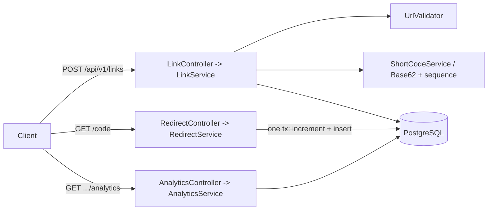
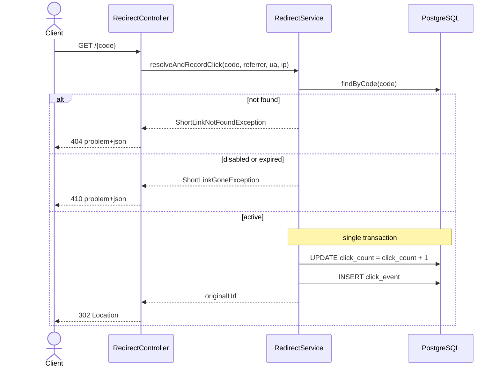
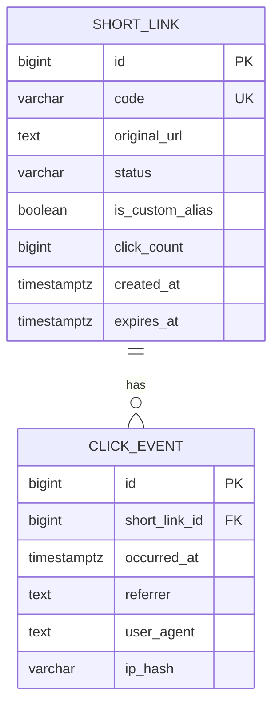

# Architecture & Design

## 1. Overview
A single-deployable **modular monolith** (Spring Boot 4.1, Java 21) backed by PostgreSQL. It exposes
REST APIs to create short links, redirect them, and read click analytics. The design is deliberately
**lean** — no message queue, cache, or multiple services — which fits the prototype scope, keeps the
consistency model simple (one DB transaction per redirect), and still keeps module boundaries clean so
pieces could be extracted later without rework.

## 2. Modules (package boundaries under `com.urlshortener`)
| Module | Responsibility | Key types |
|---|---|---|
| `shortening` | create links; short-code generation; custom aliases | `LinkController`, `LinkService`, `ShortCodeService`, `ShortCodeGenerator`, `Base62`, `CustomAliasValidator`, `ShortLink`, `ShortLinkRepository` |
| `redirect` | resolve code → 302; record the click | `RedirectController`, `RedirectService` |
| `analytics` | click events; aggregate + time series | `ClickEvent`, `ClickEventRepository`, `AnalyticsService`, `AnalyticsController` |
| `validation` | URL validation + unsafe-target checks (reusable, no DB/web coupling) | `UrlValidator`, `Malformed/UnsafeUrlException` |
| `platform` | cross-cutting web: RFC 7807 error mapping; health wiring | `GlobalExceptionHandler` |
| `common` | shared boundary marker | `package-info` |

Modules interact through Spring beans/repositories (published interfaces). `analytics` references a link
by `shortLinkId` (a plain `Long`, not a JPA relationship) to stay decoupled from the `shortening`
entity; the database still enforces the foreign key.

## 3. Control & transaction flows
```
Create:   POST /api/v1/links
          UrlValidator.validate  ->  ShortCodeService (generate Base62 from sequence | claim alias)
          ->  ShortLinkRepository.save  ->  201 + Location
          (unique constraint guards collisions: generated-code -> retry; alias -> 409)

Redirect: GET /{code}
          findByCode -> 404 if absent -> 410 if DISABLED or expired
          -> [ one @Transactional: incrementClickCount (atomic UPDATE) + insert ClickEvent ]
          -> 302 Location: <originalUrl>

Analytics: GET /api/v1/links/{code}/analytics
          findByCode -> 404 if absent
          -> totalClicks (counter) + first/last (derived queries) + per-day series (native group-by) -> 200
```


### Redirect + click recording (one transaction)


## 4. Data model
- **`short_link`**: `id` (identity PK — also the sequence source concept), `code` (UNIQUE), `original_url`,
  `status` (`ACTIVE`/`EXPIRED`/`DISABLED`, CHECK), `is_custom_alias`, `click_count` (denormalized),
  `created_at`, `expires_at`; **partial index** on `expires_at WHERE NOT NULL`.
- **`click_event`**: `id`, `short_link_id` (FK → short_link, ON DELETE CASCADE), `occurred_at`,
  `referrer`, `user_agent`, `ip_hash` (SHA-256 hex — privacy); index `(short_link_id, occurred_at)`.
- **`short_code_seq`**: sequence starting at `62^6` so generated codes are 7 chars.
- **Flyway**: `V1` baseline, `V2` core schema, `V3` sequence. Hibernate `ddl-auto=none` — **Flyway owns
  the schema** (no entity/DDL drift).



## 5. Key decisions (and why)
- **302 (configurable), not 301** — 301 is cached aggressively and would hide clicks / block edits.
- **Base62 of a DB sequence** — unique by construction (monotonic `nextval`); the UNIQUE constraint is
  the safety net; a generated code colliding with a custom alias is astronomically rare and retried.
- **Transactional click recording (no async/queue)** — counter + event insert commit together, so the
  denormalized `click_count` always matches the event rows. Trade-off: a little redirect latency.
- **Lazy expiry on read → 410** — no writes on a GET; a background sweep to persist `EXPIRED` is deferred.
- **Validation without DNS/fetch** — avoids SSRF *via the app* and latency; residual risks documented.
- **Modular monolith + env-driven config + portable (office-free) Maven settings.**

## 6. Deliberately out of scope (lean by design)
Redis/caching, NGINX/multi-instance, async/Kafka, authentication, and rate limiting are intentionally
omitted — they are not needed for a correct prototype and would add unjustified infrastructure. They are
listed, with rationale, under future scope in the engineering summary.
